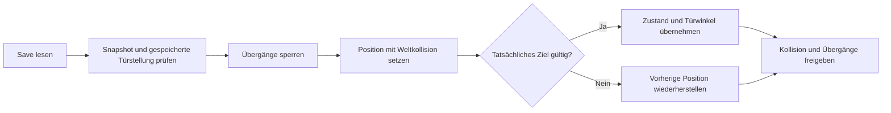

# Cloud-Fortsetzung: Weltgrenzen und zuverlässiges Speichern

Stand: **26.10.2026**. Basiscommit: `4088dc6eca48a8fd8be5eb790c402a828fe966b2`. Ziel bleibt **Unreal Engine 5.8.0**, **Prototype 0.1**, **Endless Summer 2004**. Diese Iteration verbessert das bestehende Projekt für eine spätere Engine-Abnahme auf geeigneter Hardware.

## Implementierte Änderungen

| Bereich | Gefundene Schwachstelle | Änderung |
| --- | --- | --- |
| Außenbereich | Hinter und neben dem Wohnhaus waren Bereiche innerhalb der Begrenzungen erreichbar, die keine Bodenplatte besaßen. Die Fall-Rückkehr verdeckte das Problem nur. | Eine durchgehende Bodenplatte deckt den gesamten begrenzten Nachbarschaftsbereich ab. Die kleinere überlappende Haus-Bodenplatte entfällt. |
| Weltdefinition | Start, Rückkehrpositionen, Schleifenziele, Bezirke und zulässige Ladebereiche waren unabhängig festgelegt. | `Core/NostalgiaWorldLayout` enthält gemeinsame Anker, Grenzen und Figurabmessungen für Runtime, Speicherprüfung und native Tests. |
| Startkarte | Der PlayerStart im Editor-Skript hatte eine eigene Position. | Die reflektierte Methode `NostalgiaGameMode.prototype_spawn_location()` liefert die C++-Position an `prepare_unreal.py`. GameMode-Fallback und Sicherheitsrückkehr verwenden denselben Anker. |
| Speicherprüfung | Die bisherige große Koordinatenbox akzeptierte leeren Raum zwischen Innenräumen und vorzeitig erreichbare Finale-Positionen. | `Core/NostalgiaSnapshot` prüft Zustand und Position gemeinsam: Regionen, Kapselabstand zum Rand, Fortschrittsbedingungen, endliche Blickwinkel, plausible Uhr-/Schleifenwerte und Abstand vom Loop-Trigger. |
| Speicherdaten | Schreiben und Laden kopierten viele Felder unabhängig voneinander. | `UNostalgiaSaveGame::FromSnapshot` / `ToSnapshot` bilden einen validierten Datensatz auf das bestehende USaveGame ab. Fehlerhafte Ein-/Ausgaben lassen den bisherigen Datensatz unverändert. Schema bleibt Version 1; gültige bisherige Datensätze bleiben grundsätzlich lesbar. |
| Laden und Übergänge | `TeleportTo` konnte einen Loop-Overlap auslösen, bevor der gespeicherte Zustand wiederhergestellt war. | Eine Wiederherstellungssperre verhindert Übergänge während Platzierung und Rücksetzung. Der Loop reiht dabei keinen späteren Übergangsversuch ein. Positionen mit Kapselüberschneidung zum Loop sind bereits als Speicherziel ausgeschlossen. |
| Laden und Türen | Die aktuelle Türstellung konnte einen gültigen Save bei gespeicherter offener Tür blockieren. Eine schließende Tür konnte einen später unladbaren Save erzeugen. | Gespeicherte Türstellung wird analytisch gegen die Figur geprüft. Aktuelle Tür-Kollision wird nur während der synchronen Platzierung ausgesetzt; andere Weltkollision bleibt aktiv. Erfolg stellt gespeicherte Winkel sofort her, Fehler setzt Spielerposition und Kollision zurück. Speichern im künftigen Türblatt wird abgelehnt. |
| Fotoansicht | Sprung, Ducken und Sprintstart waren trotz Fotoansicht möglich. | Diese Eingaben werden unterdrückt; Öffnen beendet Sprint und Sprungauslösung sowie Drift auf festem Boden. Schließen und erfolgreiches Laden geben die normale Bedienung frei. |

## Erfolgreiche Cloud-Prüfungen

`python3 Scripts/validate.py --sanitize` kompiliert die vier produktiven Core-Dateien gemeinsam mit GCC/C++20 und strikten Warnungen. **62/62 native C++-Tests und 9/9 Python-Tests bestanden**, ohne gemeldete AddressSanitizer-/UndefinedBehaviorSanitizer-Befunde. Die 15 zusätzlichen nativen Tests prüfen Anker und Bodenabdeckung, Welt-/Questgrenzen beim Laden, Loop-Abstand, Snapshot-Validität und Kapsel-/Tür-Geometrie einschließlich Rundungen und 90-Grad-Transformation.

Die vorhandenen Quest-, Director-, Begegnungs- und Audio-Werkzeugtests bleiben enthalten. Die Fluchtkette bleibt erhalten: Geburtstagsfoto und fehlendes Haus → Geburtstagserinnerung → veränderte Straße → dunkle Laterne → Spielhausflur.

Belege: [JSON mit Eingabe-Hashes](Validation/offline-world-save-2026-10-26.json), [C++-Log](Validation/core-world-save-2026-10-26.log), [Python-Log](Validation/python-world-save-2026-10-26.log). Hashes identifizieren die geprüften Quelldateien; der Basiscommit bezeichnet den Stand vor dieser Iteration.

## Vorbereitet, noch nicht in Unreal ausgeführt

`Nostalgia.Save.UnrealSerialization` wurde um einen gültigen Snapshot-Roundtrip durch die echte Unreal-Speicher-Serialisierung, vollständige Ereignishistorie sowie Ablehnung negativer Eventzähler, falscher Schema-/Kapitelwerte und ungültiger Positionen erweitert. Er gehört weiterhin zu den **vier vorbereiteten, nicht ausgeführten Unreal-Automationstests**.

Ungetestet bleiben UHT/UBT, Reflection der Spawn-Methode, Unreal-Python-Aufruf, Karten-/Asset-Erzeugung, reale Boden-/Türkollision, Overlap-Callbacks, Rücksetzung bei blockiertem Laden, Datenträger-Saves, Bild/Ton, PIE und Windows-Paket. Die analytische Türprüfung beschreibt die generierten, nicht skalierten Türen und ersetzt keine Physikprüfung. Frei gedrehte oder skalierte spätere Türassets benötigen eine angepasste Geometrieprüfung. Weltregionen beweisen keine freie Zielposition oder tragfähigen Boden unter einem beliebigen manipulierten Save.

## Tatsächlicher Fertigstellungsstand

Ein erweiterter UE-5.8.0-Quellprototyp mit vorhandenem Abschnitt, Dream Director, ortsgebundenen Testklängen, erster begrenzter Heimkehrer-Begegnung, Escape-Kette und geprüften Core-Modulen liegt im Repository. Ein getesteter spielbarer Build liegt weiterhin **nicht** vor. Keine neuen lokalen Installationsversuche. Das sparsame Grafikprofil und der Asset-Generator bleiben erhalten; eine geeignete Engine-Maschine muss die offenen Integrationsprüfungen durchführen.
