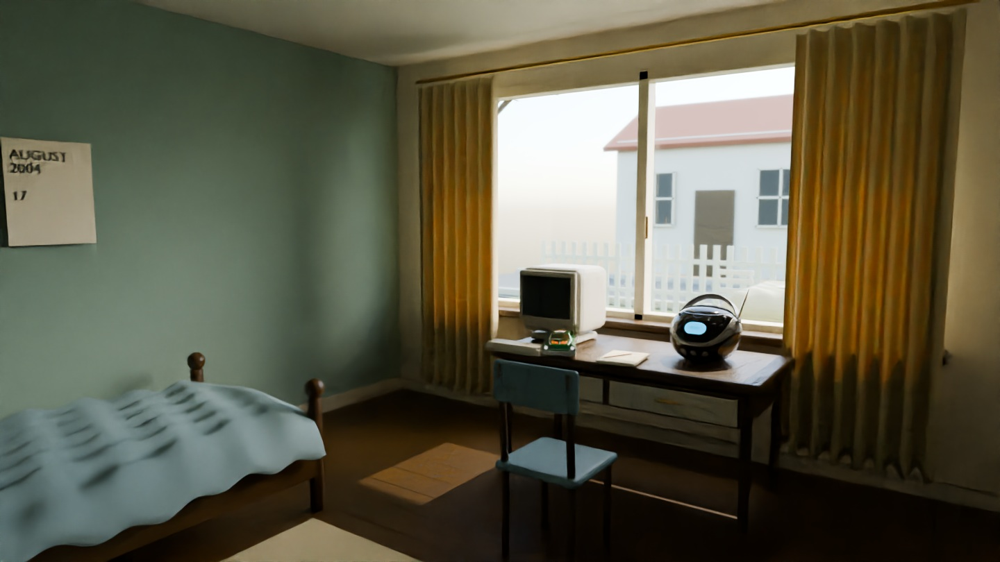

# NOSTALGIA · Quality Overhaul 0.2

Stand: 26.10.2026. **Konkrete Szene und Unreal-Import vorbereitet; kein in Unreal geprüfter Vertical Slice.**

Unreal bleibt das Hauptprojekt. Diese Iteration konzentriert sich auf ein Kinderzimmer von 2004, den angrenzenden Wohnbereich, den Garten und drei Hausfassaden im Blickfeld. Die Browser-Testversion 0.1 wurde nicht grafisch zum Hauptprojekt ausgebaut. Die drei bestehenden Escape-Konzepte bleiben im bisherigen Core erhalten; weitere Level wurden nicht entwickelt.

## Was tatsächlich vorliegt

- Fünf heruntergeladene, lizenzierte 3D-Quellmodelle mit eingebetteten PBR-Texturen: Radio, Spielzeugauto, Polstersessel, Sofa und Pflanze. Originaldateien, Quellen, konkrete Upstream-Commits und SHA-256-Werte liegen unter `SourceArt/Quality02/ThirdParty` und `sources.lock.json`.
- Neun echte GLB-Dateien für die eingerichtete Szene. Dazu gehören ausgearbeitete Holzrahmen, Fensteröffnungen, Sprossen, Griffe, Vorhänge mit Falten, Bettgestell und Textilien, Schreibtisch mit Schubladen, CRT-Gehäuse samt Lüftungsschlitzen und Tastatur, Bücher, Notizbuch, Kalender, Sockelleisten und Steckdosen. Architektur und diese Ergänzungen sind eigene parametrisch modellierte Meshes; keine referenzierten Engine-Würfel als finale Möbel.
- Ein kuratiertes Gartenarrangement: gedeckter Tisch, drei nahe Stühle und ein abseits stehender vierter, Wegplatten, Zaun und zwei Bäume. Das vertraute Zimmer blickt direkt auf eine verlassene Feier. Es gibt keine schwebenden Quest-Schilder in dieser Szene.
- Native Unreal-Klassen für die eigene Szene, zwei schwenkende Türen mit geprüftem Bewegungsbogen gegen Pawn-Kollision, vorhandener First-Person-Charakter mit angepasster Bewegung und bestehender Dream Director für das Gartenereignis.
- Ein Importskript, das diese Dateien in echte Unreal-Assets und eine Karte überführt, sobald es in UE 5.8.0 ausgeführt wird. Es erzeugt keine vorgetäuschten `.uasset`-/`.umap`-Dateien in der Cloud.

Das ist eine erste ausgearbeitete Asset-/Szenenfassung. **Die Hausfassaden, Pflanzen, Oberflächen und eigenen Möbel sind noch nicht als endgültige Art-Qualität abgenommen.** Der Garten benötigt insbesondere bessere Vegetation, Bodenübergänge, Alterung und Architekturdetails. Der Vollständigkeit eines hochwertigen, fotorealistischen Vertical Slice entspricht diese Fassung noch nicht.

## Echte Rendernachweise

Die folgenden Bilder werden aus der tatsächlichen Szene mit **Blender 4.3.2 / Cycles auf der CPU** gerendert. Sie sind **keine Unreal-Screenshots, keine Gameplay-Aufnahmen und keine Referenzbilder**. Konventionelle Intel-Open-Image-Denoise-Entrauschung wird ausgewiesen; die unveränderten Cycles-Rohansichten sind daneben verfügbar. Keine generative Bildsynthese ergänzt Möbel oder Umgebung.

[Unentrauschter Zimmer-Render](Renders/01_Bedroom_Blender_raw.jpg) · [Garten](Renders/02_Garden_Blender.jpg) · [Wohnbereich](Renders/03_Living_Blender.jpg)

Lichtberechnung und Materialauswertung unterscheiden sich zwischen Blender und Unreal. Blender benutzt Nishita-Himmel und Cycles; der Unreal-Aufbau verwendet SkyAtmosphere, VolumetricCloud, SkyLight und das optionale Lumen-Profil. Besonders Stoff-Sheen, transparente Verglasung, Blätter, Belichtung und indirektes Licht müssen im echten Unreal-Viewport verglichen werden. **Schöne Unreal-Wolken sind vorbereitet, aber hier nicht gerendert oder abgenommen.**

Die Rohdaten des Nachweises stehen in [Validation/blender-build.json](Validation/blender-build.json): Kameraorte, Renderer, Samples, Entrauschung, Skript- und Bildprüfsummen.

## Bewegung und Spieleransicht

Die Quality-Karte verwendet den bestehenden `ANostalgiaCharacter` über eine kleine Spezialisierung. Gehen ist dort auf 220 cm/s, Sprint auf 380 cm/s abgestimmt. Beschleunigung und Bremsen wurden begrenzt. Die zusätzliche Gehbewegung der Kamera bleibt unter 0,55 cm, läuft nur am Boden und klingt im Stillstand aus. Sprint-FOV bewegt sich weich zwischen 82° und 85°. **M** schaltet diese zusätzliche Bewegung und den Sprint-Zoom ab; Blickrichtung und Zielstrahl werden nicht künstlich verzögert.

Die normale Unreal-Ansicht zeigt keine dauernde Aufgabenliste, Tastaturtabelle, Versionsnummer oder technischen Zustände. Am erreichbaren Interaktionsobjekt erscheint ein kleiner Punkt mit **E**. **H** öffnet freiwillige Hilfe, **F3** das Entwicklungs-Overlay. Datum/Uhrzeit erscheinen kurz am Anfang und auf **Tab**. Die Uhr ist noch eine schlichte HUD-Anzeige; ein animiertes Hand-/Uhrenmodell fehlt.

**WASD/Maus** bewegen und schauen, **Shift** sprintet, **Strg** duckt, **Leertaste** springt, **E** bedient die beiden Türen. Handanimationen, physisches Aufheben von Gegenständen, Radio-Bedienung und die neue Fotoansicht fehlen noch. Die platzierten Gegenstände sind bislang überwiegend Umgebungsdetails.

Die Quality-Karte nutzt eine andere Raumaufteilung als 0.1. Daher sind **F5/F9 dort bewusst deaktiviert**, damit keine alten Blockout-Spielstände geladen oder überschrieben werden. Das bestehende Speichersystem bleibt im bisherigen Prototyp erhalten. Ein eigenes Quality-Szenen-Saveformat ist offen.

## Gartenklang: verbunden, Aufnahme fehlt

Der AudioDirector hat jetzt zuweisbare Sound-Assets und Quellpositionen. In der Quality-Karte sind synthetische Ersatzsignale abgeschaltet. Ohne freigegebene Aufnahme bleibt das Ereignis still und wird vom Director nicht als abgespielt verbucht.

Die vorbereitete Inszenierung:

1. Der Spieler erreicht den Garten, bleibt mindestens 2,4 Sekunden im Bezirk und bewegt sich beim Auslösen mit höchstens 200 cm/s.
2. Die einzelne Monoquelle sitzt am Geburtstagstisch, etwa 1,1 m hoch. Das Startfenster liegt zwischen 3 und 11 m Entfernung.
3. Der bereits vorhandene Director quittiert nur tatsächlich gestartete Wiedergabe; maximal eine Wiedergabe pro Sitzung/Zustand. Erneutes Betreten startet kein identisches Lachen.
4. Unter 3 m Nähe oder beim Verlassen des Gartens blendet die Aufnahme in 0,35 Sekunden aus. Sichtkanal-Occlusion dämpft auf 25 % und filtert auf 1,2 kHz; Luftdämpfung ist aktiviert.

Eine **natürliche, rechtlich geklärte Kinderlachen-Aufnahme ist nicht enthalten**. Freesound und OpenGameArt waren aus dieser Cloud nicht erreichbar. Wir behaupten weder natürliche Aufnahmequalität noch einen gehörten Unreal-Audiotest. Schritte auf verschiedenen Materialien, Ventilator, Vögel und entfernte Umweltaufnahmen bleiben ebenfalls offen. Anforderungen und Importziel: [AUDIO.md](AUDIO.md).

## Unreal-Zugriff und spätere Ausführung

In dieser Sitzung sind keine Unreal-MCP-Dispatch- oder Statuswerkzeuge verfügbar. In der Cloud wurden weder ein Unreal-Prozess noch `UnrealEditor`, `UnrealEditor-Cmd` oder `RunUAT` gefunden. Der installierte Codex-Skill allein stellt keine Live-Verbindung zum Windows-PC her. Es wurde **kein erneuter lokaler Installationsversuch** vorgenommen.

[IMPORT_UNREAL.md](IMPORT_UNREAL.md) beschreibt den konkreten Import-/Aufbauprozess für einen späteren geeigneten UE-Rechner. Das Standardprofil des bisherigen Projekts bleibt sparsam. `-CustomConfig=Quality02` aktiviert separat DX12/SM6, Software-Lumen, virtuelle Schatten und TSR. Es gibt noch keine gemessene Unreal-Bildrate; die Einstellungen sind ein Startpunkt für geeignete Hardware, kein Leistungsversprechen für den bisherigen PC.

## Abnahme und offene Arbeit

[VALIDATION.md](VALIDATION.md) trennt durchgeführte Cloud-Tests von ausstehenden Unreal-Prüfungen. [ASSET_LICENSES.md](ASSET_LICENSES.md) enthält konkrete Quellen, Rechte und Änderungen.

Vor einem vorzeigbaren Unreal-Vertical-Slice fehlen insbesondere: tatsächlicher UE-Import und UHT/UBT-Build, Kollisions-/Türtest in PIE, visuelle Material- und Lichtabnahme, natürliches Audio mit geklärten Rechten, überzeugende Außenflächen und Vegetation, animierte Interaktionen sowie Messungen von Bildrate und Speicherbedarf. Die neue Szene führt noch keine komplette Escape-Kette aus; diese bleibt im 0.1-Prototyp erhalten.
